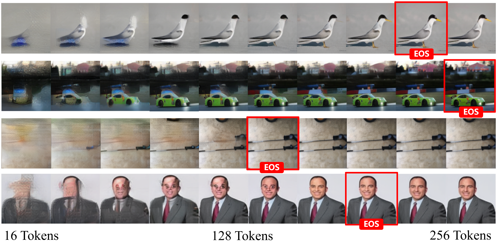
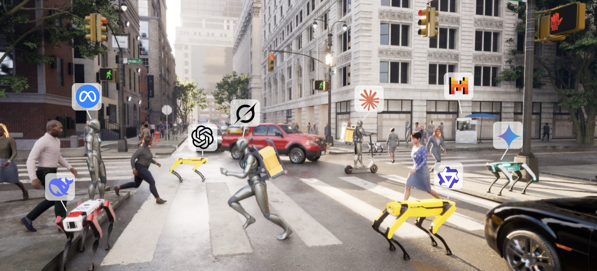
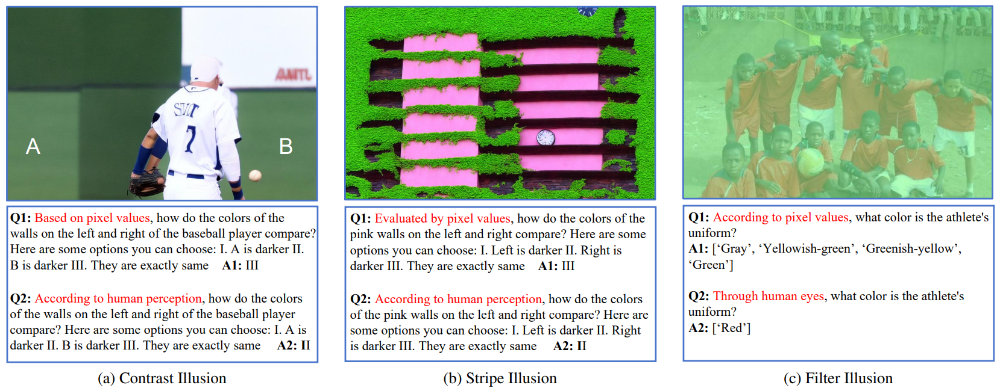
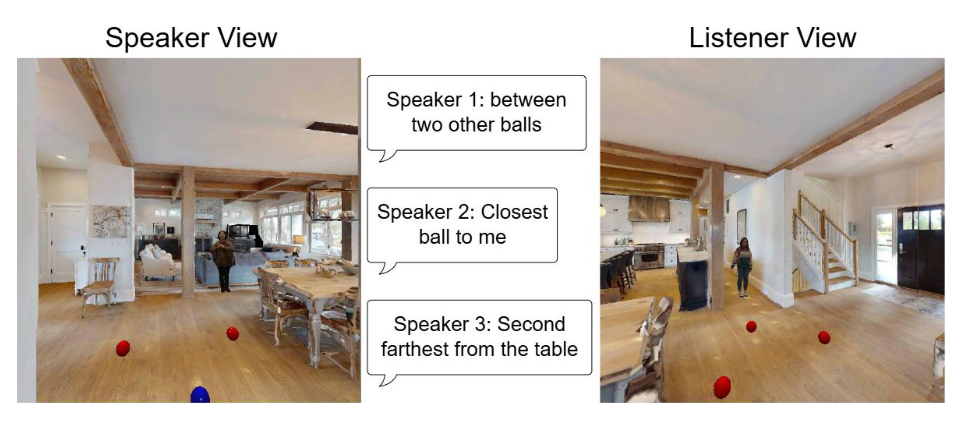
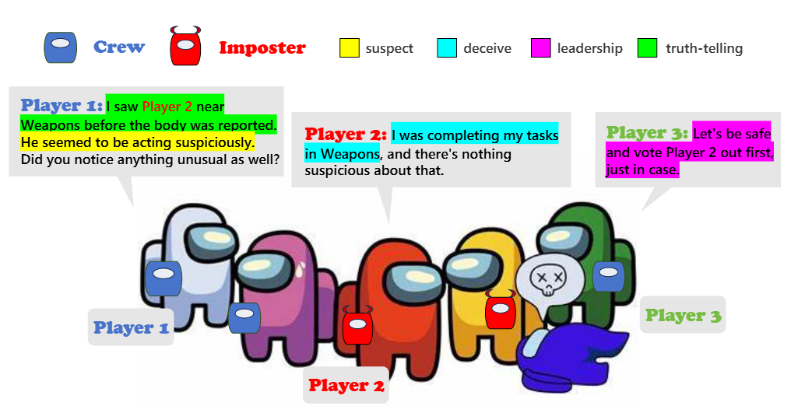
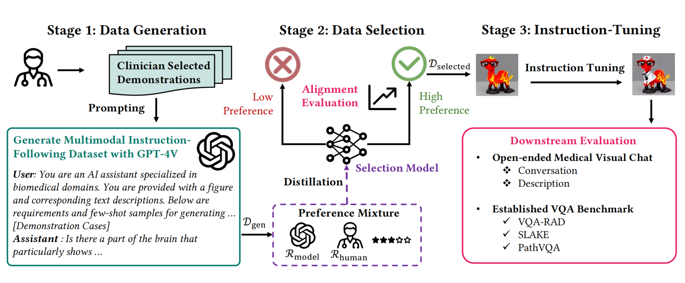
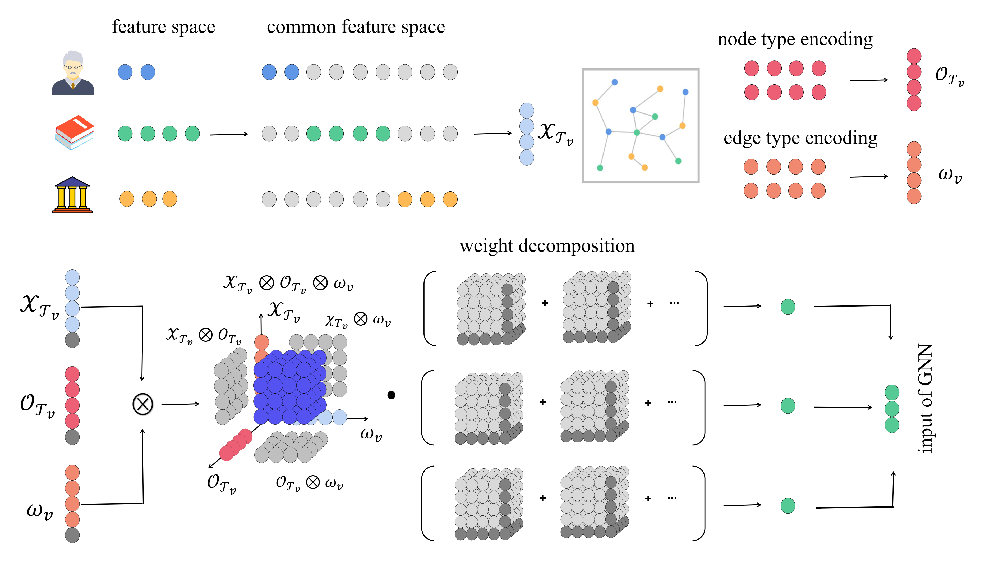
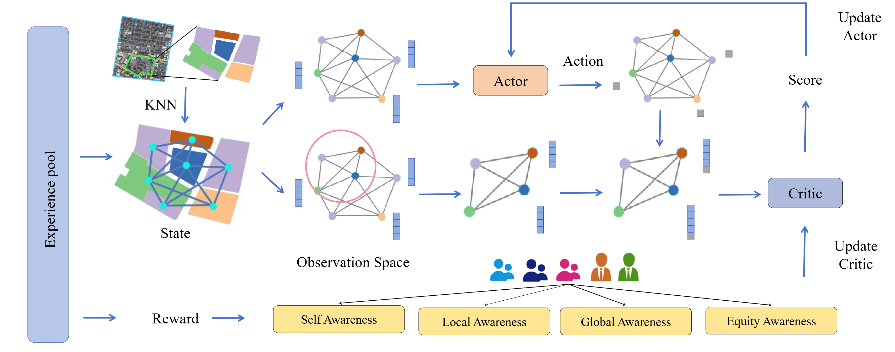








# Welcome! 
I am a second-year Ph.D. student at [University of California San Diego](https://cse.ucsd.edu/) (UCSD), advised by [Prof. Biwei Huang](https://biweihuang.com/). I am also working at [Aether AI](https://aetherlabs.ai/), where I lead the robotics group. During my undergraduate studies, I was a Visiting Researcher at the [Berkeley NLP Group](https://nlp.cs.berkeley.edu/), working with [Prof. Alane Suhr](https://www.alanesuhr.com/).

My research focuses on **robot foundation models**, **embodied agents**, and **world simulation**. Currently, I am working on building robot intelligence systems (e.g., [CRIS-0](https://aetherlabs.ai/articles/real-world-autonomous-robotic-system-with-causality-driven-agent-and-world-model)), as well as developing realistic world simulations (e.g., SimWorld) for agent training. In the long term, my goal is to build general-purpose embodied intelligence that can autonomously learn, reason, and act in the physical world, generalizing across embodiments and tasks from only a few demonstrations.

You can find my [CV](https://drive.google.com/file/d/1cYcl2w3z3J7tdv5NVDf3QYNRQ05bsLw6/view?usp=sharing) here. I am always open to any form of collaboration. If you have any ideas for potential collaboration, or just feel like having a casual chat, please feel free to reach out!

<!--I have published more than 100 papers at the top international AI conferences with total <a href='https://scholar.google.com/citations?user=DhtAFkwAAAAJ'>google scholar citations <strong>260000+</strong></a> (You can also use google scholar badge ).-->

<!--插入图片语法为：-->

# 🔥 News
- *2026.10*: &nbsp;We release RobotAgentBench, a benchmark for open-world robot autonomy.
- *2026.07*: &nbsp;Our work DeliveryBench has been accepted to COLM 2026.
- *2026.03*: &nbsp;Joined Aether AI to lead the robotics group.
- *2025.04*: &nbsp;Thrilled to join UCSD as a Ph.D. student. Looking forward to starting this new journey!🌴🌊☀️
- *2025.02*: &nbsp;Our work on evaluating VLMs on photorealistic color illusion scenes has been accepted to CVPR 2025.
- *2024.09*: &nbsp;Our work on multi-perspective communication has been accepted by EMNLP main 2024.
- *2024.09*: &nbsp;Our work on multimodal instruction-tuning for biomedicine has been accepted to NeurIPS D&B 2024!

# 📰 Blog

<video class="demo-preview" src="../assets/video/CRIS-0-teaser.mp4" poster="../assets/video/CRIS-0-poster.jpg" autoplay muted loop playsinline preload="auto"></video>▶ Watch demo

[Building a Real-world Autonomous Robotic System with Causality-driven Agent and World Model](https://aetherlabs.ai/articles/real-world-autonomous-robotic-system-with-causality-driven-agent-and-world-model)

**Lingjun Mao†**, Lukun He†, Jinglin Cao†, Wenpeng Xu†, …, Kun Zhou\*, Biwei Huang

Aether AI, 2026<a href="https://aetherlabs.ai/articles/real-world-autonomous-robotic-system-with-causality-driven-agent-and-world-model">Blog</a><a class="press" href="https://mp.weixin.qq.com/s/lmF7cN9YymTF5ETwp1WCtg">机器之心</a><a class="press" href="https://mp.weixin.qq.com/s/Kc4EZEeHjup6Rq0GSDJx2A">量子位</a><a class="press" href="https://techcrunch.com/sponsor/aether-ai/aether-ai-builds-causal-intelligence-for-the-real-world/">TechCrunch</a><a class="press" href="https://mp.weixin.qq.com/s/uL8SdX26sUuPGYH41lcofA">甲子光年</a>

- CRIS-0 is a causality-driven robotic intelligence system that integrates a Causal Agent with a Causal World Model to construct structured causal representations of the physical world, enabling robots to actively explore, intervene in, reason about, and adapt to their environments.

# 📝 Publications 
<!-- 

[Images are Worth Variable Length of Representations](https://arxiv.org/abs/2506.03643)

**Lingjun Mao**, Rodolfo Corona, Xin Liang, Wenhao Yan, Zineng Tang

[**Project**](https://arxiv.org/abs/2506.03643) | <strong>Arxiv 2025</strong>
- We propose DOVE, a dynamic vision encoder that produces a variable number of tokens to reconstruct each image.
- We extend DOVE with query-conditioned tokenization, which enables more efficient and targeted semantic extraction.

 -->

<video class="demo-preview" src="../assets/video/RAB-teaser.mp4" poster="../assets/video/RAB-poster.jpg" autoplay muted loop playsinline preload="auto"></video>▶ Watch demo

[RobotAgentBench: Towards Open-world Robot Autonomy](https://aetherlabsai.github.io/RobotAgentBench/)

**Lingjun Mao†**, Jinglin Cao†, Lukun He†, Wenpeng Xu, Yuchen Yan, …, Kun Zhou\*, Biwei Huang

arXiv 2026<a href="https://aetherlabsai.github.io/RobotAgentBench/">Project Page</a><a href="https://arxiv.org/abs/2610.34649">arXiv</a><a href="https://github.com/AetherLabsAI/RobotAgentBench">Code</a><a href="https://huggingface.co/datasets/AetherLabs-AI/RobotAgentBench-TrainingData">Dataset</a><a href="https://huggingface.co/AetherLabs-AI/InternVLA-A1.5-RAB">Model</a><a class="press" href="https://mp.weixin.qq.com/s/ci35Mz_2o7lL-E4ocPuReg">机器之心</a>

- We introduce RobotAgentBench (RAB), a benchmark for evaluating robot agents in realistic, open-world household environments, covering task discovery, context reasoning, manipulation, failure recovery, and robustness across 50 real-to-sim household layouts.

<video class="demo-preview" src="../assets/video/DeliveryBench-teaser.mp4" poster="../assets/video/DeliveryBench-poster.jpg" autoplay muted loop playsinline preload="auto"></video>▶ Watch demo

[DeliveryBench: Can Agents Earn Profit in Real World?](https://deliverybench.github.io/)

**Lingjun Mao**, Jiawei Ren, Kun Zhou, Jixuan Chen, Ziqiao Ma, Lianhui Qin†

COLM 2026<a href="https://deliverybench.github.io/">Project Page</a><a href="https://arxiv.org/abs/2512.19234">arXiv</a><a href="https://github.com/SimWorld-AI/DeliveryBench">Code</a><a href="https://huggingface.co/datasets/SimWorld-AI/DeliveryBench">Dataset</a><a class="press" href="https://mp.weixin.qq.com/s/JwYNLK0j_bTRi-YpmiqIuA">具身智能之心</a>

- We present DeliveryBench, a realistic embodied benchmark for food delivery that evaluates long-horizon, constraint-rich decision-making to maximize net profit over hours.

<!-- 

[SimWorld: An Open-ended Realistic Simulator for Autonomous Agents in Physical and Social Worlds](https://simworld.org/)

Jiawei Ren\*, Yan Zhuang\*, Xiaokang Ye\*, **Lingjun Mao**, Xuhong He, Jianzhi Shen, …, Tianmin Shu†, Zhiting Hu†, Lianhui Qin†

Technical Report<a href="https://simworld.org/">Project Page</a><a href="https://arxiv.org/abs/2512.01078">arXiv</a><a href="https://github.com/SimWorld-AI/SimWorld">Code</a><a href="https://simworld.readthedocs.io/en/latest/">Docs</a><a href="https://simworld.org/leaderboard">Leaderboard</a>

- We propose SimWorld Simulator, featuring three key designs: (1) realistic, open-ended world simulation, (2) rich interface for LLM/VLM agents, and (3) diverse physical and social reasoning scenarios

 -->

[Evaluating Model Perception of Color Illusions in Photorealistic Scenes](https://arxiv.org/abs/2412.06184)

**Lingjun Mao**, Zineng Tang, Alane Suhr 

CVPR 2025<a href="https://arxiv.org/abs/2412.06184">arXiv</a><a href="https://github.com/mao1207/RCID">Code</a>

- We propose an automated framework for generating realistic color illusion images, build a large-scale dataset (RCID), and systematically investigate the underlying mechanisms by which VLMs are misled by color illusions.

<!-- 

[Grounding Language in Multi-Perspective Referential Communication](https://arxiv.org/abs/2410.03959)

Zineng Tang, **Lingjun Mao**, Alane Suhr 

EMNLP 2024 Main<a href="https://arxiv.org/abs/2410.03959">arXiv</a><a href="https://aclanthology.org/2024.emnlp-main.1100/">Paper</a><a href="https://github.com/zinengtang/MulAgentRef">Code</a>

- We introduce a task and dataset for referring expression generation and comprehension in multi-agent embodied environments.

 -->

<!--
[**Project**](https://scholar.google.com/citations?view_op=view_citation&hl=zh-CN&user=DhtAFkwAAAAJ&citation_for_view=DhtAFkwAAAAJ:ALROH1vI_8AC) <strong></strong>
- Lorem ipsum dolor sit amet, consectetur adipiscing elit. Vivamus ornare aliquet ipsum, ac tempus justo dapibus sit amet. 

-->

<!-- 

[AMONGAGENTS: Evaluating Large Language Models in the Interactive Text-Based Social Deduction Game](https://arxiv.org/abs/2407.16521)

Yizhou Chi, **Lingjun Mao**, Zineng Tang

[**Project**](https://arxiv.org/abs/2407.16521) | <strong>ACL Wordplay Workshop 2024</strong>
- This paper focuses on creating proxies of human behavior in simulated environments, with “Among Us” utilized as a tool for studying simulated human behavior.

 -->

[Biomedical Visual Instruction Tuning with Clinician Preference Alignment](https://biomed-vital.github.io/)

 Hejie Cui*, **Lingjun Mao\***, Xin Liang, Jieyu Zhang, Hui Ren, Quanzheng Li, Xiang Li, Carl Yang

NeurIPS 2024 D&amp;B<a href="https://biomed-vital.github.io/">Project Page</a><a href="https://arxiv.org/abs/2406.13173">arXiv</a><a href="https://github.com/mao1207/BioMed-VITAL">Code</a><a href="https://huggingface.co/datasets/mao1207/BioMed-VITAL-instructions">Dataset</a><a href="https://huggingface.co/mao1207/BioMed-VITAL-models">Models</a>

- we propose a data-centric framework (Biomed-VITAl) that incorporates clinician preferences into both stages of generating and selecting instruction data for tuning biomedical multimodal foundation models.

<!-- 

[BG-HGNN: Toward Scalable and Efficient Heterogeneous Graph Neural Network](https://arxiv.org/abs/2403.08207)

Junwei Su*, **Lingjun Mao\***, Chuan Wu

[**Project**](https://arxiv.org/abs/2403.08207) | <strong>ArXiv 2024</strong>
- We first highlights and demonstrates that the standard approach employed by existing HGNNs inevitably leads to parameter explosion and relation collapse.

[AI Agent as Urban Planner: Steering Stakeholder Dynamics in Urban Planning via Consensus-based Multi-Agent Reinforcement Learning](https://arxiv.org/abs/2310.16772) 

Kejiang Qian, **Lingjun Mao**, Xin Liang, Yimin Ding, Jin Gao, Xinran Wei, Ziyi Guo, Jiajie Li

[**Project**](https://arxiv.org/abs/2310.16772) | <strong>ArXiv 2024</strong>
- we introduce a Consensus-based Multi-Agent Reinforcement Learning framework for real-world land use readjustment.

 -->

# 📖 Educations
- *2024.09 - 2024.10*, Visiting Student in University of California, Berkeley, USA
- *2020.09 - 2025.7*, Software Engineering (GPA: 4.0/4.0), Tongji University, Shanghai, China

<!-- # 💻 Internships
- *Feb 2024 - Present*: Berkeley NLP Group, Berkeley Artificial Intelligence Research (BAIR) Lab
- *Nov 2023 - Jun 2024*: Department of Computer Science, Emory University
- *Apr 2023 - May 2024*: Department of Computer Science, University of Hong Kong
- *Apr 2022 - Nov 2023*: City Science Lab@Shanghai (MIT Media Lab)
- *Sept 2021 - Nov 2023*: Tongji ADE Lab
- *May 2021 - Apr 2023*: Tongji NaMI Lab -->

------

  <i>2026@Lingjun Mao</i>

